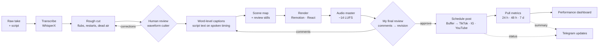

<h1 align="center">Content Editor Engine</h1>

  <b>An agent-operated pipeline that turns a raw talking-head recording into a published, measured short-form video.</b> 
  Transcription · AI cutting · captions &amp; B-roll · Remotion rendering · human review · auto-posting · performance tracking

<b>🎬 2-minute demo video: coming soon</b>

<!-- When the demo is published, replace the line above with:

<a href="VIDEO_URL"><b>▶ Watch the 2-minute demo</b></a>

-->

  
  
  
  
  

---

## At a glance

| | Before (mobile editor) | After (this engine) |
|---|---|---|
| Time per 1-minute video | 70–80 min of manual editing (2 h+ for a new style) | ~12 min unattended processing + a few minutes of review |
| A week of 7 videos | ~8–9.5 hours of manual work | ~1.5 hours unattended (one batch) + ~30 min review |
| Rough cut accuracy | Done by ear | The AI's suggestions alone catch 94–98% of what I'd cut by hand |
| Posting & stats | Upload to each app, check numbers by hand | Scheduled to TikTok, Instagram and YouTube; views and watch time collected automatically |
| Rough cut | Listening for every flub without a waveform | Automatic. Every cut lands in measured silence |
| Captions & effects | Copy-pasted by hand | Template + config, word-accurate timing |
| Audio | As recorded | Mastered to −14 LUFS, true peak ≤ −1 dBTP |
| Consistency | Varies with effort | Same style system for every video |

Used every week for my own short-form videos · ~30K lines of TypeScript & Python · source is private ([why](#why-is-the-source-private)).

## The problem

I publish short talking-head videos. Editing one minute of video by hand meant finding every stumble, re-take and pause by ear, then adding captions, titles and sound effects one by one on a phone, because the desktop editor I'd use doesn't run on Linux. That took 70–80 minutes per video (over two hours for a new style), and quality depended on how much energy I had left. Then each video still had to be uploaded to every platform, and its numbers checked by hand.

## How it works

1. **Transcribe.** WhisperX gives word-level timestamps. Each speech chunk is transcribed on its own, so restarts stay visible and hallucinated text in silences can be filtered out.
2. **Cut.** The pipeline detects restarts (a line re-said by the next take), filler-only takes and noise. It also flags stalls, look-aways and off-camera moments with MediaPipe face tracking. These visual flags are only raised for review and never cut anything on their own.
3. **Review.** A browser-based cutter shows the waveform, transcript and every proposed cut. I accept, adjust or add cuts.
4. **Caption & compose.** My script's wording is laid onto the spoken timing. Stock B-roll comes from the Unsplash and Pixabay APIs, through filters for AI-generated slop and content my audience shouldn't see, and every stock shot gets an on-screen credit. A style template (one folder per style) turns a single config file into the full composition.
5. **Render & master.** Remotion renders the video. The audio is mastered to broadcast loudness, then automated checks run (flash gate, review stills).
6. **Review, publish & measure.** I watch the final, leave comments for a revision or approve it. Approved videos are scheduled through Buffer to TikTok, Instagram and YouTube (one a day). Views, likes, shares and average watch time are pulled back at 24 hours, 48 hours and 7 days into a dashboard, and Telegram tells me when a video is ready, posted or failed, with a 48-hour performance summary.

**AI cut mode:** for a whole batch, the agent cuts every take itself from the detector's suggestions plus its own editing pass, then goes straight on to the final. On a test batch, the detector's suggestions alone caught 94–98% of what I cut by hand, before the agent's own editing pass, so most of my time goes into the final review, not the rough cut.

**The agent runs by itself:** a small runner starts at login, picks up each job from the editor and runs it in its own fresh Claude Code session (model and effort set per job type), so no terminal has to stay open.

## Key engineering decisions

- **Deterministic rules around probabilistic models.** Speech recognition and face tracking *propose*. Hard rules decide (e.g. *every cut must land in silence*) and a human approves.
- **One config file per video.** Styles live in templates. If making a video requires editing anything other than a config file, the template gets fixed for every video instead of forking it.
- **The AI operates the tool. It doesn't hand-author edits.** Claude Code drives the pipeline from a written operating manual (`CLAUDE.md`), so a whole edit can start from one sentence while the output stays reproducible.
- **Feedback becomes rules.** When I correct a cut, I measure my own correction and turn it into a rule. Example: my cuts left ~0.06–0.10 s of audible gap where the pipeline left ~0.5–0.7 s, which became the "punchy" cut style.

## What broke, and what I learned

| Problem | Fix | Lesson |
|---|---|---|
| Whisper "heard" sentences in silent gaps that were never said | Transcribe each chunk alone and filter hallucinations | Treat model output as a proposal, and design for its known failure modes |
| Cuts clipped the start or end of words | Hard rule: cuts must land in measured silence, plus seam matching to the best-matching frames (jump seams 5 → 1 on a test take) | Encode taste as measurable constraints |
| Rough cuts felt slow ("not punchy") | Measured my manual cuts and adopted their timings as a new cut style | Human feedback is data |
| The AI cost per video was ~10× my first estimate (about US$1.50, not RM0.60) | Instrumented every run: half the bill was the agent re-reading earlier videos' history, so each job now runs in a fresh session; further savings are tested one change at a time against fixed quality gates and a golden set | An agent's cost is turns × context size, not the prompt. Measure before optimising |
| Scheduling hit Buffer's free-plan limit (250 requests a day) | Ask only about posts that are due, cache channels, and back off on HTTP 429 until `Retry-After` | Design for rate limits from day one |
| Glances at the phone weren't detected, because the eyes barely move when the phone is near the lens | Track the head instead: a change of ≥ 7% in face size flags an off-camera moment | Measure the signal that actually changes, not the one you assumed |

## Human in the loop

A small browser app (Node.js built-in HTTP server + plain JavaScript; the only UI library is the waveform renderer) is where I work with the agent:

- **Cut:** the take's waveform, transcript and every proposed cut. I can play any seam, scrub, accept or adjust a cut, or add one the detector missed.
- **Review:** the final video, with comments that send it back for a revision.
- **Post:** the caption for each platform, and scheduling.
- **Performance:** each video's numbers, plus the AI cost and the minutes I spent on it.
- **Agent panel:** what the agent is working on, and a live, step-by-step view of what it did.

<!-- When ready: 

 -->

## How AI is used

- **To build it:** I developed the whole system with Claude Code as my primary development environment.
- **To run it:** Claude Code operates the pipeline from `CLAUDE.md`. It runs the steps, reads the reports and stops at the review gates.
- **Upstream:** the scripts come from a separate Claude skill I wrote. It's versioned, has quality gates, and draws personal claims only from a verified fact file, to stop invented stories.

## Tech stack

**Video & UI:** TypeScript, React, Remotion · **Audio & ML:** Python, WhisperX, MediaPipe, FFmpeg · **Integrations:** Buffer API, Cloudflare R2, Telegram Bot API, Unsplash/Pixabay APIs · **Tooling:** Node.js, shell, systemd, Claude Code

## Roadmap

- [x] Auto-posting to TikTok, Instagram and YouTube
- [x] Automatic performance tracking (24 h / 48 h / 7 d)
- [x] Telegram notifications
- [ ] Cut the AI cost per video further without losing quality (measured experiments, one change at a time)
- [ ] Detect abandoned sentences (false starts) automatically
- [ ] Send a take from my phone through Telegram
- [ ] Facebook as a fourth channel

## Why is the source private?

The engine bundles a paid third-party template pack that I'm not licensed to redistribute, and it's wired to my own recordings and scripts. I'm happy to walk through the code live in an interview.

---

Built by <a href="https://github.com/farisnizam">Faris Nizam</a> · <a href="https://linkedin.com/in/farisnizam">LinkedIn</a> · farisnizamdev@gmail.com

