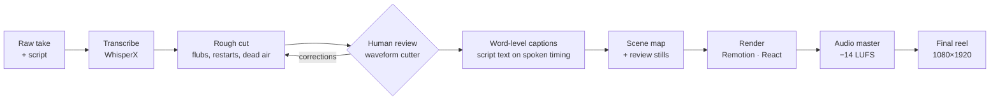

<h1 align="center">Content Editor Engine</h1>

  <b>An agent-operated pipeline that turns a raw talking-head recording into a finished, captioned vertical video.</b> 
  Transcription · automatic flub &amp; dead-air cutting · word-level captions · Remotion rendering · loudness mastering · human review

<b>🎬 2-minute demo video: coming soon</b>

<!-- When the demo is published, replace the line above with:

<a href="VIDEO_URL"><b>▶ Watch the 2-minute demo</b></a>

-->

  
  
  
  
  

---

## At a glance

| | Before (mobile editor) | After (this engine) |
|---|---|---|
| Time per 1-minute video | ~80–110 min of manual editing | ~12 min unattended processing + a few minutes of review |
| A week of 7 videos | ~9–13 hours of manual work | ~1.5 hours unattended (one batch) + ~30 min review |
| Rough cut | Listening for every flub without a waveform | Automatic. Every cut lands in measured silence |
| Captions & effects | Copy-pasted by hand | Template + config, word-accurate timing |
| Audio | As recorded | Mastered to −14 LUFS, true peak ≤ −1 dBTP |
| Consistency | Varies with effort | Same style system for every video |

Used every week for my own short-form videos · ~20K lines of TypeScript & Python · source is private ([why](#why-is-the-source-private)).

## The problem

I publish short talking-head videos. Editing one minute of video by hand meant finding every stumble, re-take and pause by ear, then adding captions, titles and sound effects one by one on a phone, because the desktop editor I'd use doesn't run on Linux. That took 1–2 hours per video, and quality depended on how much energy I had left.

## How it works

1. **Transcribe.** WhisperX gives word-level timestamps. Each speech chunk is transcribed on its own, so restarts stay visible and hallucinated text in silences can be filtered out.
2. **Cut.** The pipeline detects restarts (a line re-said by the next take), filler-only takes and noise. It also flags stalls, look-aways and off-camera moments with MediaPipe face tracking. These visual flags are only raised for review and never cut anything on their own.
3. **Review.** A browser-based cutter shows the waveform, transcript and every proposed cut. I accept, adjust or add cuts.
4. **Caption & compose.** My script's wording is laid onto the spoken timing. A style template (one folder per style) turns a single config file into the full composition.
5. **Render & master.** Remotion renders the video. The audio is mastered to broadcast loudness, then automated checks run (flash gate, review stills).

Two ways to run it: **batch mode** (rough-cut a whole batch, review, then render) and **one-shot mode** (straight from take to final render, which I use when the rough cut needs no changes).

## Key engineering decisions

- **Deterministic rules around probabilistic models.** Speech recognition and face tracking *propose*. Hard rules decide (e.g. *every cut must land in silence*) and a human approves.
- **One config file per video.** Styles live in templates. If making a video requires editing anything other than a config file, the template gets fixed for every video instead of forking it.
- **The AI operates the tool. It doesn't hand-author edits.** Claude Code drives the pipeline from a written operating manual (`CLAUDE.md`), so a whole edit can start from one sentence while the output stays reproducible.
- **Feedback becomes rules.** When I correct a cut, I measure my own correction and turn it into a rule. Example: my cuts left ~0.06–0.10 s of audible gap where the pipeline left ~0.5–0.7 s, which became the "punchy" cut style.

## What broke, and what I learned

| Problem | Fix | Lesson |
|---|---|---|
| Whisper "heard" sentences in silent gaps that were never said | Transcribe each chunk alone and filter hallucinations | Treat model output as a proposal, and design for its known failure modes |
| Cuts clipped the start or end of words | Hard rule: cuts must land in measured silence, plus seam matching to the best-matching frames (jump seams 5 → 1 on a test take) | Encode taste as measurable constraints |
| Rough cuts felt slow ("not punchy") | Measured my manual cuts and adopted their timings as a new cut style | Human feedback is data |
| Glances at the phone weren't detected, because the eyes barely move when the phone is near the lens | Track the head instead: a change of ≥ 7% in face size flags an off-camera moment | Measure the signal that actually changes, not the one you assumed |

## Human in the loop

A small browser app (Node.js server + vanilla JS) shows the take's waveform, the transcript and every proposed cut. I can play any seam, drag the playhead to scrub, accept or adjust a cut, or add one the detector missed. The corrections are saved back into the batch file, so the render uses exactly what I approved, and repeated corrections become new default rules.
<!-- When ready: 

 -->

## How AI is used

- **To build it:** I developed the whole system with Claude Code as my primary development environment.
- **To run it:** Claude Code operates the pipeline from `CLAUDE.md`. It runs the steps, reads the reports and stops at the review gates.
- **Upstream:** the scripts come from a separate Claude skill I wrote. It's versioned, has quality gates, and draws personal claims only from a verified fact file, to stop invented stories.

## Tech stack

**Video & UI:** TypeScript, React, Remotion · **Audio & ML:** Python, WhisperX, MediaPipe, FFmpeg · **Tooling:** Node.js, shell, Claude Code

## Roadmap

- [ ] Telegram bot front door: send a take → get review stills → approve → receive the final video
- [ ] Detect abandoned sentences (false starts) automatically
- [ ] Timed benchmarks per stage

## Why is the source private?

The engine bundles a paid third-party template pack that I'm not licensed to redistribute, and it's wired to my own recordings and scripts. I'm happy to walk through the code live in an interview.

---

Built by <a href="https://github.com/farisnizam">Faris Nizam</a> · <a href="https://linkedin.com/in/farisnizam">LinkedIn</a> · farisnizamdev@gmail.com

